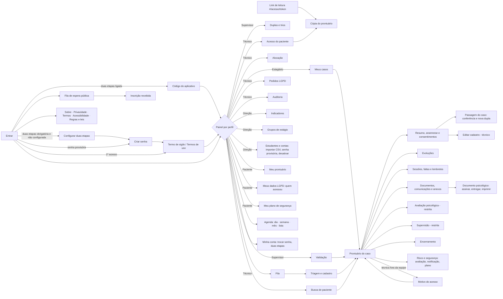

# Diagramas do Vínculo (Etapa 2)

Os diagramas usam Mermaid: o GitHub desenha direto nesta página.

## DER — Diagrama entidade-relacionamento

Cada entidade é uma coleção de `dados/dados-iniciais.json` e uma tabela de `banco/schema.sql`.

```mermaid
erDiagram
    PACIENTES ||--o{ CASOS : "tem"
    PACIENTES ||--o| USUARIOS : "conta do paciente"
    PACIENTES ||--o{ SOLICITACOES : "pede cópia"
    USUARIOS ||--o{ GRUPOS : "supervisiona"
    GRUPOS ||--o{ SUBGRUPOS : "divide em duplas/trios"
    USUARIOS ||--o{ ALOCACOES : "vínculo de estágio"
    GRUPOS ||--o{ ALOCACOES : "recebe"
    SUBGRUPOS ||--o{ ALOCACOES : "forma"
    GRUPOS ||--o{ CASOS : "atende"
    SUBGRUPOS ||--o{ CASOS : "atende"
    INSCRICOES |o--o| CASOS : "vira caso na triagem"
    CASOS ||--o{ ANAMNESES : "versões"
    CASOS ||--o{ CONSENTIMENTOS : "por finalidade"
    CASOS ||--o| ENCERRAMENTOS : "encerra"
    CASOS ||--o{ SESSOES : "agenda"
    SESSOES ||--o{ LEMBRETES : "lembra"
    CASOS ||--o{ EVOLUCOES : "registra"
    SESSOES |o--o{ EVOLUCOES : "da sessão"
    EVOLUCOES ||--o{ ADENDOS : "corrige"
    EVOLUCOES ||--o{ ASSINATURAS : "assinada"
    DOCUMENTOS ||--o{ ASSINATURAS : "assinado"
    ANAMNESES ||--o{ ASSINATURAS : "assinada"
    CASOS ||--o{ DOCUMENTOS : "emite"
    CASOS ||--o{ ANEXOS : "anexa"
    CASOS ||--o{ AVALIACOES : "área restrita"
    CASOS ||--o{ ORIENTACOES : "supervisão"
    CASOS ||--o{ CONTATOS : "fluxo de abandono"
    SOLICITACOES ||--o{ LINKS_ACESSO : "link temporário"
    USUARIOS ||--o{ ACEITES : "aceita termos"
    USUARIOS ||--o{ AUDITORIA : "ações"
    CASOS ||--o{ RISCOS : "avaliação de risco"
    RISCOS ||--o{ NOTIFICACOES : "notificação compulsória"
    CASOS ||--o{ PLANOS_SEGURANCA : "versões"
    PLANOS_SEGURANCA ||--o{ ASSINATURAS : "assinado"
    USUARIOS ||--o{ ACESSOS_JUSTIFICADOS : "registra o motivo"
    CASOS ||--o{ ACESSOS_JUSTIFICADOS : "acessado com motivo"
    CASOS ||--o{ TRANSFERENCIAS : "passa para outra dupla"
    SUBGRUPOS ||--o{ TRANSFERENCIAS : "recebe o caso"
    EVOLUCOES |o--o| TRANSFERENCIAS : "resumo de transferência"
    DOCUMENTOS ||--o{ EVENTOS_DOCUMENTO : "entrega, devolutiva, anulação"
    CASOS ||--o{ COMUNICACOES : "compartilhamentos"

    PACIENTES {
        text id PK
        text nome
        text nome_social
        date data_nascimento
        text cpf UK
        text telefone
        text email
        text responsavel_nome
        text emergencia_nome
        text emergencia_telefone
        text canal_lembrete
    }
    USUARIOS {
        text id PK
        uuid auth_id UK
        text nome
        text login UK
        text email UK
        text perfil
        text crp
        text matricula UK
        text paciente_id FK
        bool senha_provisoria
        bool ativo
    }
    GRUPOS {
        text id PK
        text nome
        text foco
        text supervisor_id FK
    }
    SUBGRUPOS {
        text id PK
        text grupo_id FK
        text nome
    }
    ALOCACOES {
        text id PK
        text estagiario_id FK
        text grupo_id FK
        text subgrupo_id FK
        date inicio
        date fim
    }
    INSCRICOES {
        text id PK
        text nome
        date data_nascimento
        text cpf
        bool sem_cpf
        text telefone
        text resumo
        text status
        jsonb duplicidade
        bool sinal_urgencia
        text risco_triagem
        text encaminhado_para
        text caso_id FK
    }
    CASOS {
        text id PK
        text paciente_id FK
        text grupo_id FK
        text subgrupo_id FK
        text status
        date inicio
    }
    ANAMNESES {
        text id PK
        text caso_id FK
        int versao
        text autor_id FK
        text demanda
        text objetivos
        text queixa
    }
    CONSENTIMENTOS {
        text id PK
        text caso_id FK
        text finalidade
        bool concedido
        text termo_versao
        text registrado_por FK
        timestamptz em
    }
    ENCERRAMENTOS {
        text id PK
        text caso_id FK
        date data
        text tipo
        text motivo
        text destino
    }
    SESSOES {
        text id PK
        text caso_id FK
        date data
        time hora
        text presenca
        bool confirmada
        text sala
        bool aviso_paciente
        text motivo_falta
    }
    EVOLUCOES {
        text id PK
        text caso_id FK
        text sessao_id FK
        text autor_id FK
        text status
        text texto
        text comentario_supervisor
        text tipo
    }
    ASSINATURAS {
        text id PK
        text alvo_tipo
        text alvo_id
        text usuario_id FK
        text papel
        text hash
    }
    ADENDOS {
        text id PK
        text evolucao_id FK
        text autor_id FK
        text motivo
        text texto
    }
    ORIENTACOES {
        text id PK
        text caso_id FK
        text supervisor_id FK
        text texto
    }
    DOCUMENTOS {
        text id PK
        text caso_id FK
        text tipo
        text titulo
        text finalidade
        text destinatario
        jsonb conteudo
        text validade
    }
    EVENTOS_DOCUMENTO {
        text id PK
        text documento_id FK
        text tipo
        text para
        text observacao
        text registrado_por FK
    }
    COMUNICACOES {
        text id PK
        text caso_id FK
        text tipo
        date data
        text destinatario
        text finalidade
        text fundamento
        bool visivel_paciente
        text registrado_por FK
    }
    ANEXOS {
        text id PK
        text caso_id FK
        text nome
        text tipo
        int tamanho
        text hash
    }
    AVALIACOES {
        text id PK
        text caso_id FK
        text instrumento
    }
    CONTATOS {
        text id PK
        text caso_id FK
        text canal
        text resultado
        text motivo
    }
    LEMBRETES {
        text id PK
        text sessao_id FK
        text canal
    }
    SOLICITACOES {
        text id PK
        text paciente_id FK
        text caso_id FK
        text status
        text forma
    }
    LINKS_ACESSO {
        text id PK
        text solicitacao_id FK
        text token_hash UK
        timestamptz expira_em
    }
    PEDIDOS_TITULAR {
        text id PK
        text titular_tipo
        text titular_id
        text tipo
        text status
    }
    ACEITES {
        text id PK
        text usuario_id FK
        text termo
        text versao
    }
    RISCOS {
        text id PK
        text caso_id FK
        text registrado_por FK
        text tipo
        text nivel
        text descricao
        jsonb condutas
        text ciencia_por FK
        timestamptz encerrado_em
    }
    NOTIFICACOES {
        text id PK
        text risco_id FK
        text caso_id FK
        text orgao
        text registrado_por FK
        text protocolo
    }
    PLANOS_SEGURANCA {
        text id PK
        text caso_id FK
        int versao
        text autor_id FK
        text sinais_alerta
        text pessoas_ajuda
        text servicos
        bool revisado_com_paciente
    }
    TRANSFERENCIAS {
        text id PK
        text caso_id FK
        text de_subgrupo_id FK
        text para_grupo_id FK
        text para_subgrupo_id FK
        text resumo_id FK
        text justificativa
        bool paciente_avisado
        text registrado_por FK
    }
    ACESSOS_JUSTIFICADOS {
        text id PK
        text usuario_id FK
        text caso_id FK
        text motivo
        text detalhe
        timestamptz em
    }
    AUDITORIA {
        bigint seq
        text id PK
        timestamptz em
        text usuario_id
        text acao
        text alvo
        text hash_anterior
        text hash
    }
```

## Diagrama de navegação

## Casos de uso (atualizado)

```mermaid
flowchart LR
    subgraph Atores
      PA((Paciente))
      VI((Visitante))
      ES((Estagiário))
      SU((Supervisor))
      TE((Psicólogo técnico))
      DI((Direção))
    end
    VI --- U1[Entrar na fila de espera]
    PA --- U2[Confirmar presença]
    PA --- U3[Pedir cópia do prontuário]
    PA --- U4[Ver e corrigir dados, revogar autorizações - LGPD]
    PA --- U19[Avisar que não vai à sessão]
    PA --- U20[Ler o plano de segurança, ver quem acessou e com quem os dados foram compartilhados]
    ES --- U5[Registrar anamnese e evolução]
    ES --- U6[Registrar presença, agendar, enviar lembrete]
    ES --- U7[Fluxo de abandono: contato e motivo]
    ES --- U8[Emitir documento psicológico, registrar comunicação e anexar arquivos]
    ES --- U21[Registrar risco e plano de segurança]
    ES --- U25[Escrever o resumo de transferência]
    SU --- U9[Validar ou devolver evolução]
    SU --- U10[Registrar orientação de supervisão]
    SU --- U11[Formar duplas e trios]
    SU --- U22[Dar ciência do risco e registrar notificação compulsória]
    SU --- U26[Validar o resumo e passar o caso para outra dupla]
    TE --- U12[Triar, cadastrar e checar CPF]
    TE --- U13[Alocar caso a grupo]
    TE --- U14[Entregar cópia e gerar link temporário]
    TE --- U15[Responder pedidos LGPD]
    TE --- U16[Verificar auditoria]
    TE --- U23[Registrar o motivo do acesso e criar o acesso do paciente ao portal]
    DI --- U17[Importar estudantes e encerrar vínculos]
    DI --- U18[Ver indicadores agregados]
    DI --- U24[Gerar senha provisória e desativar contas]
```

